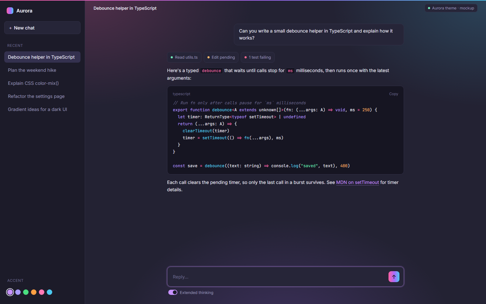
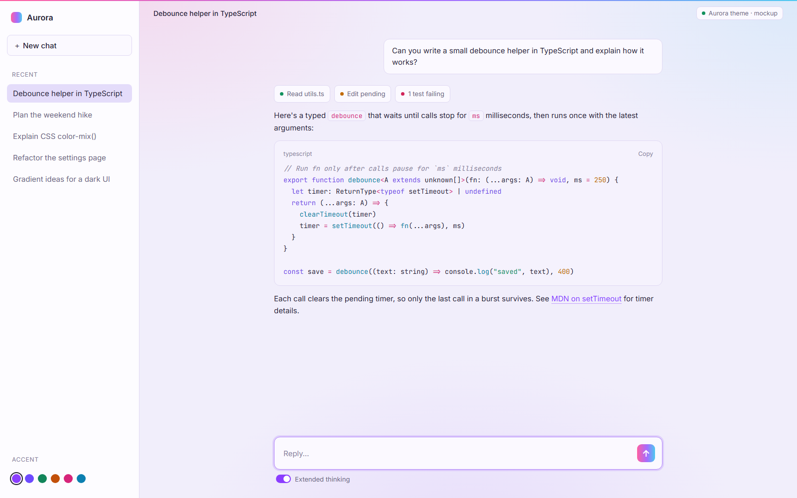

# Aurora theme

**Dark mode**



**Light mode**



<sub>Mockups of the theme's colors, not actual screenshots of the app.</sub>

A Claude look built from the Aurora design tokens. Dark mode uses violet-tinted night surfaces; light mode uses lilac paper. The chat area gets the Aurora corner wash (pink, violet and cyan glows) and a 2px glow line along the top edge.

Switch the accent with `/aurora <aurora | purple | green | orange | pink | teal>` (remembered across sessions); `/aurora` alone shows the current one. Code colors follow the token guide: keywords use the accent, strings `--ok`, names `--danger`, variables `--warn`, literals `--hl-cyan`.

Draws in the Claude desktop and mobile apps; the terminal does not draw themes.

## Install

At the prompt of a Claude Code terminal session:

```
/plugin install aurora-theme --marketplace jgruber96/claude-aurora-theme
```

From a shell:

```
claude plugin install aurora-theme --marketplace jgruber96/claude-aurora-theme
```

Answer `y` to add the marketplace, then pick a scope (user scope is first; press Enter).

In the Claude desktop app, where `/plugin` doesn't run: click **+** next to the prompt box, then **Plugins**, **Add marketplace** with `jgruber96/claude-aurora-theme`, then **Add plugin**.
